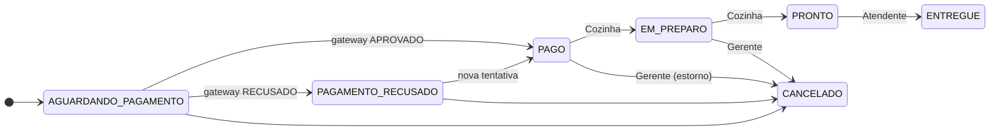

# Diagramas

Fontes em Mermaid (`.mmd`, renderizadas automaticamente pelo GitHub abaixo) e imagens em [`png/`](png/).

| Arquivo | Diagrama |
|---|---|
| [01-casos-de-uso.mmd](01-casos-de-uso.mmd) | Casos de uso (atores e funcionalidades) |
| [02-der.mmd](02-der.mmd) | DER completo — entidades, PK/FK, cardinalidades (espelha `prisma/schema.prisma`) |
| [02a](02a-der-catalogo-estoque.mmd), [02b](02b-der-clientes-lgpd.mmd), [02c](02c-der-pedidos-pagamentos.mmd) | DER dividido em três visões (usadas no documento) |
| [03-classes.mmd](03-classes.mmd) | Classes de domínio + portas |
| [04-sequencia-pedido-pagamento.mmd](04-sequencia-pedido-pagamento.mmd) | Sequência do fluxo crítico |
| [05-estados-pedido.mmd](05-estados-pedido.mmd) | Máquina de estados do pedido |
| [06-arquitetura-camadas.mmd](06-arquitetura-camadas.mmd) | Arquitetura em camadas |
| [07-implantacao.mmd](07-implantacao.mmd) | Implantação proposta (produção) |

## Estados do pedido

